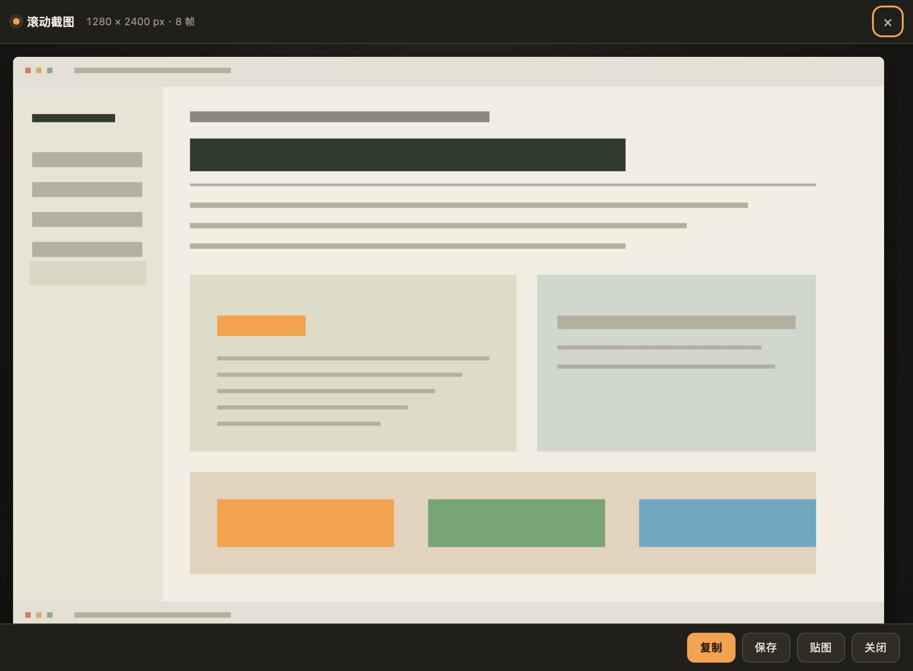

# Pinstill · 钉图

**Screenshot → annotate in place → copy / pin / save → back to history**, all from one hotkey.
Pure Go + system WebView: no Electron, no cgo. Screenshots stay on your Mac.

[中文文档](README.md) · [Features](#features) · [Screenshots](#screenshots) · [Build from source](#build-from-source) · [Architecture](#architecture) · [Development](#development)

[](https://github.com/echoVic/Pinstill/actions/workflows/ci.yml)
[](LICENSE)


## What it is

Pinstill (pin + still) is a desktop screenshot and annotation tool for macOS (Windows build is
cross-compiled but not yet verified on real hardware). It keeps the whole capture workflow on the
desktop: select a region, annotate it in place, copy it, pin it on top of other windows, and browse
the capture history later.

- The screenshot appears **inside the selection** on your desktop, with the annotation toolbar
  floating next to it — no separate editor window.
- Pins are always-on-top borderless windows that survive app restarts.
- Everything is local: images are read through an internal `shot://` protocol, no network, no uploads.

## Features

- **Region capture + in-place toolbar**: full-screen selection (dim mask, crosshair, size badge),
  flicker-free capture through the transparent selection, then annotate with rectangle / ellipse /
  line / arrow / pen / text / tag / mosaic / highlight / watermark, plus undo, colours and width.
- **Text styles**: bold / italic, size 10–32pt, font family (system / PingFang / Helvetica /
  Georgia / Menlo), remembered across captures and previewed live in the inline editor.
- **Tiled watermark**: toggle a sparse, diagonal (-30°) repeated watermark over the whole image with
  configurable text, opacity, colour and size.
- **Palette panel**: 40 presets, SV square, hue slider, hex input, recent colours.
- **Pins**: drag to place, scroll to scale, ⌘/Ctrl+scroll for opacity, right-click menu, double-click
  to copy, Esc to close; positions/sizes/opacity restored after a restart.
- **Scrolling capture**: automatic scrolling and stitching by default, auto-finish when the page
  stops moving, tall-image result preview (copy / save / pin), manual fallback; the selection frame
  stays visible while capturing.
- **History**: capture cards with thumbnails, large preview, copy / save / pin / delete, retention by
  days and total size.
- **System integration**: menu-bar tray, global hotkeys (⌘⇧1 capture, ⌘⇧2 pin clipboard, ⌘⇧O OCR),
  7 settings categories, permission centre for screen recording / accessibility / launch at login.
- Double-click the canvas or press Enter to copy; Esc cancels; drag the selection corners to adjust
  the region and recapture.

OCR, translation and QR decoding are clearly marked as *not implemented yet*.

## Screenshots

All screenshots are generated from synthetic demo images (`PINSTILL_SELFTEST=showcase`); no user
desktop content is included.

| | |
|---|---|
|  |  |
|  |  |
|  |  |

## Build from source

Requirements: macOS 13+, Xcode Command Line Tools, Go (see [go.mod](go.mod)), Node.js 22+ and npm.

```bash
git clone https://github.com/echoVic/Pinstill.git
cd Pinstill
npm install
npm run build:web
./node_modules/.bin/mygo build        # or: npm run build
open build/darwin-arm64/Pinstill.app
```

Development mode with Vite HMR: `npm run dev`.

On first launch, grant **Screen Recording** (required for captures); automatic scrolling capture
also needs **Accessibility**.

## Architecture

- **Shell**: [MyGo](https://mygo.egoist.dev/) (Go + system WebView, no cgo) — windows, tray, global
  shortcuts, clipboard, custom protocol, Go ↔ JS bindings/events.
- **Frontend**: Vite + TypeScript, one HTML entry per window: `index` (history/settings), `overlay`,
  `pin`, `scroll`, `result`, `frame`.
- **Go packages**: `internal/app` (orchestration), `internal/capture` (platform capture backends +
  permission preflight), `internal/store` (history), `internal/pin` (pins), `internal/stitch`
  (scroll stitching).
- Captures are served to the WebView through a custom protocol instead of base64.

## Development

```bash
GOTOOLCHAIN=auto go test ./...
GOTOOLCHAIN=auto go vet ./...
npm run build:web

# end-to-end acceptance: full build + 23 app-level selftests
bash work/e2e.sh
bash work/e2e.sh --skip-build
```

The e2e suite covers real quit, real capture + history + clipboard, overlay rendering, selection
mapping, in-place annotation flows, pins (including restart restore), scrolling capture, history
actions, hotkey registration, settings, permissions, palette, text styles, watermark, and more.
Use `PINSTILL_DATA_DIR=/tmp/pinstill-data` to isolate captures, pins and session files.

## Limitations

- Windows backend is cross-compiled and unverified on real hardware (HiDPI mapping may be off).
- OCR / translation / QR are not implemented.
- Scrolling capture depends on Accessibility; fixed headers/footers can break stitching; limits are
  120 frames / 30000px.
- The overlay covers the visible work area (menu bar and Dock excluded on macOS).
- Launch-at-login reports `Operation not permitted` when the app is not in `/Applications`.
- Mixed-DPI multi-monitor setups are not fully tested.

## Contributing

Issues and PRs are welcome. Before submitting, please keep `gofmt`, `go vet`, `go test ./...` and
ideally `bash work/e2e.sh --skip-build` green, and avoid committing `build/`, `dist/`,
`node_modules/` or real screenshots of your desktop. Commit messages use conventional prefixes
(`feat:`, `fix:`, `docs:`, ...).

## License

[MIT](LICENSE) © 2026 echovic

## Acknowledgements

MyGo, Vite, Lucide and all upstream open-source dependencies.
