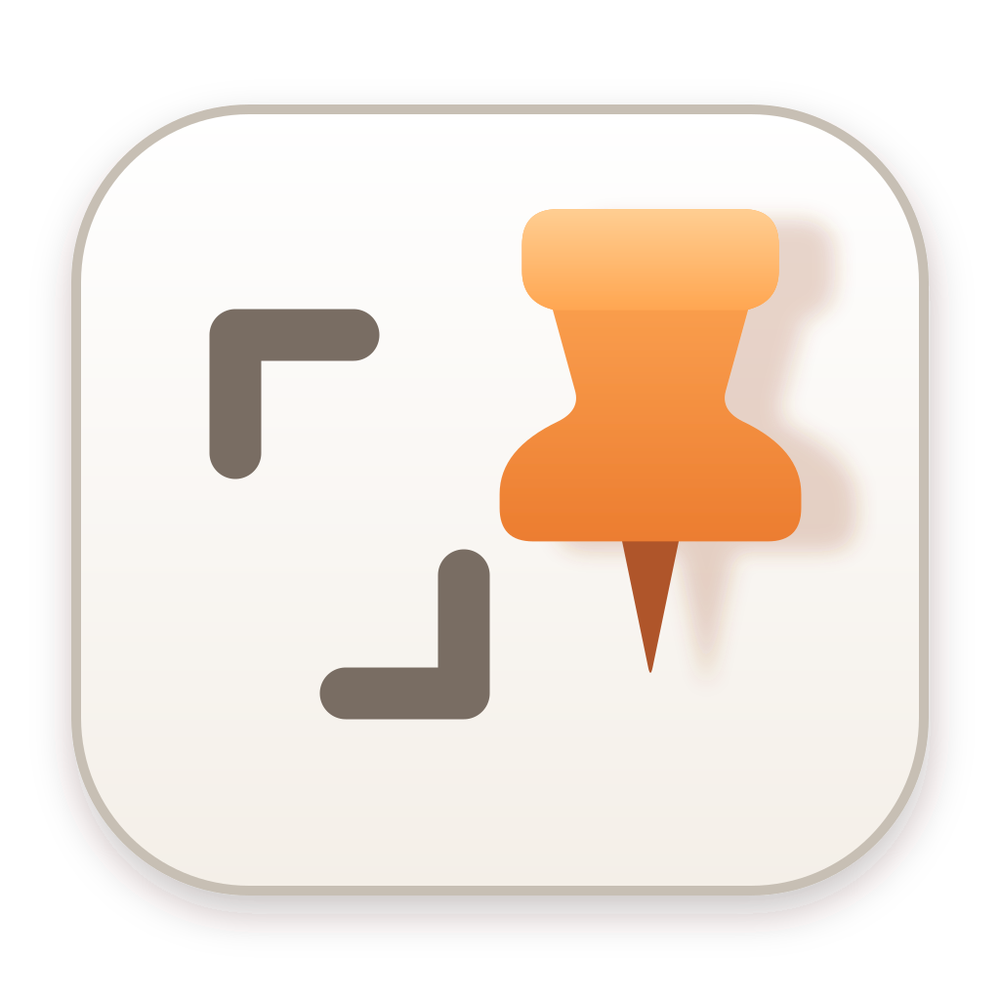
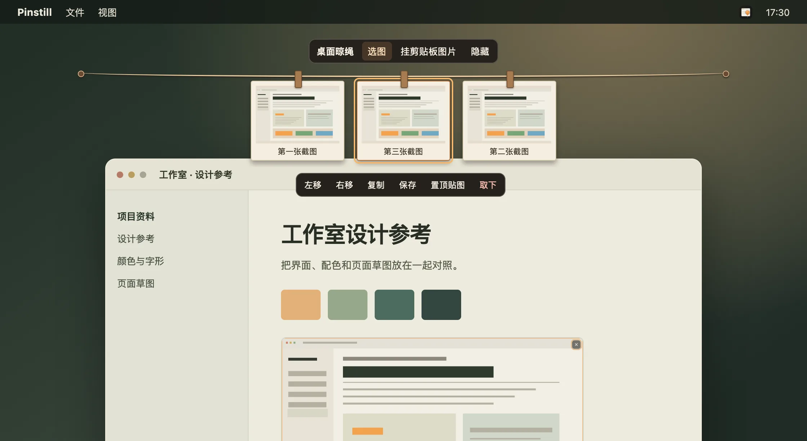
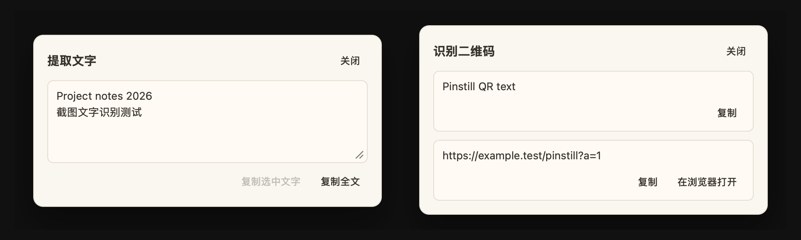

# Pinstill · 钉图



[简体中文](README.md) | English

Pinstill is a free, open-source screenshot tool for Mac. Press **⌘⇧1** to select a region, then mark it up, capture a scrolling page, extract text or read QR codes. Keep several reference images side by side just below the menu bar while you work. Capture and built-in recognition run on your Mac.

[Website](https://pinstill.echovic.com/en/) · [Download the latest release](https://github.com/echoVic/Pinstill/releases/latest) · [Changelog](CHANGELOG.md)

[](https://github.com/echoVic/Pinstill/actions/workflows/ci.yml)
[](LICENSE)




## Download

Open the signed, Apple-notarized Universal DMG and drag Pinstill into Applications. It runs on macOS 13 or later on Apple silicon and Intel Macs. Allow Screen Recording in System Settings before your first capture. [Download for Mac](https://github.com/echoVic/Pinstill/releases/latest)

Starting with `v0.1.3`, Pinstill checks for updates in the background. You can also choose “检查更新…” (Check for Updates) from its menu bar icon. By default, Pinstill asks before downloading and installing. On `v0.1.2` or earlier, replace the app using the latest DMG once. [Release instructions for maintainers](docs/releasing.md)

## Capture and mark up

1. Press **⌘⇧1** or choose Capture Region from the menu bar. Drag a selection or click a highlighted window. Double-click a highlighted window to copy it straight to the clipboard.
2. The markup toolbar opens with no tool selected by default. Within one display, drag inside the box to move it, or drag an edge or corner to resize it. If a markup tool is active, hold `Option` to move the box. Releasing captures the new area and resets existing markup. Region capture can also span displays. [Capture and markup demo](https://pinstill.echovic.com/en/#annotate)
3. Copy, save, pin or hang from the toolbar. By default, `Enter` or a double-click on the canvas copies the image, and `Esc` cancels. Change the shortcuts and default capture action in Settings.

- **Freeze the desktop**　Region capture freezes the current desktop image. To capture a Chrome extension popup, open it first and then press the capture shortcut. The menu bar also offers full-screen capture.
- **Zoom, sample colour and measure**　Use the arrow keys to fine-tune the endpoint while selecting, or hold `Shift` for 10-point steps. Press `Z` for the pixel loupe, `C` to copy the displayed HEX colour, and `M` to measure from the pointer in screen points (pt). With a selection on one display, use `Option` + arrows to move it, or add `Shift` to resize. [Precision tools demo](https://pinstill.echovic.com/en/#precision)
- **Edit annotations**　The toolbar includes rectangles, arrows, text, mosaic, highlights and tiled watermarks. The default markup colour is red; choose another from the 40-colour palette or enter a HEX value. Press `V` to select an annotation and move it, recolour it or change its stroke width. Double-click text or a tag to edit it. Use `Delete` to remove it, `⌘Z` to undo and `⌘⇧Z` to redo.

## Pin and hang images

- **Floating pins**　Choose Pin for an independent window that stays on top, or press **⌘⇧2** to pin a clipboard image. Move, resize, fade, rotate, flip or make a pin click-through. Use Pin Manager to group pins, show or hide a group, or restore clicks. Pinstill restores up to 60 active pins at launch and keeps older pins in the history archive. [Pin management demo](https://pinstill.echovic.com/en/#pin)
- **Desktop clothesline**　Choose Hang to place a capture in the row of images just below the main display's menu bar. The row floats above ordinary windows, and you can drag the images to reorder them. Hang from the capture toolbar, scrolling preview or history, or add a file or clipboard image. Select an image to copy, save, pin or remove it. Toggle the clothesline from the menu bar. Images, order and visibility are restored at launch. [Desktop clothesline demo](https://pinstill.echovic.com/en/#clothesline)

## Text extraction and QR codes

Select a region and choose **Extract Text**. With the model service off, built-in OCR recognises Chinese and English by default and preserves line breaks. Copy a selection or the whole result. Choose a language for built-in OCR in Settings → Recognition & Translation.

Choose **Scan QR Code** to scan your selection on your Mac with macOS Vision. Copy the text or review the full web address before opening it. Opening a link in your browser ends the capture. Press `Esc` to close the results and continue marking up or saving. [Recognition demo](https://pinstill.echovic.com/en/#recognition)



### Screenshot translation and model OCR

Under Settings → Recognition & Translation → Model Service, choose a local model or a cloud API and enter the OpenAI-compatible base URL and model ID. Ollama defaults to `http://127.0.0.1:11434/v1`, and LM Studio defaults to `http://127.0.0.1:1234/v1`. Cloud services require HTTPS and an API key. The system keychain stores the configuration. Select Off and save to remove it.

- **Extract Text**　Once configured, an image-capable model handles text extraction first, including handwriting and complex layouts. Translate the result from the same panel, or switch to built-in OCR.
- **Translate**　Pinstill uses the configured model to recognise the selection, then translates the extracted text. Copy the original and translation separately. Choose on-device OCR to send only the extracted text to the model.
- **Cloud confirmation**　Pinstill shows the destination and asks before sending the selected image.

## Scrolling capture and history

- **Scrolling capture**　Select a region within one display and choose Scrolling Capture. Scroll by hand and choose Finish Now, or enable Auto Scroll in the controls with Accessibility permission. If two frames do not line up, Pinstill keeps the stitched portion and asks you to scroll back slightly. Capture finishes at 120 frames, 30,000 pixels in height or 32 Mi pixels. [Scrolling capture demo](https://pinstill.echovic.com/en/#scroll)
- **Capture history**　Open History & Settings from the menu bar. In the preview you can copy, save, pin, hang or delete a capture. Set how long captures are kept and how much space history may use in Settings.

## Data and permissions

- Capture history, pins and clothesline images use `captures/`, `pins/` and `clothesline/` under `~/Library/Application Support/Pinstill/`. The current selection and scrolling preview are kept in memory.
- The app reads screenshots through the local `shot://localhost/...` protocol. Built-in OCR and QR recognition run on your Mac. Model services are off by default. When enabled, they receive content from the actions described above. Pinstill connects to GitHub to check for and download updates.
- Screen Recording permission is needed for capture. Automatic scrolling also needs Accessibility. Settings → Permissions shows permission and launch-at-login status.

## Development

You need Go 1.27+ (see `go.mod`), Node 22+ and npm.

```bash
npm ci
npm run build:web          # build the frontend into dist/
npm run build              # build the macOS app
npm run dev                # Vite HMR with the MyGo window
```

Run `npm run generate` to refresh frontend bindings after changing Go services or events. For development, use `PINSTILL_DATA_DIR=/tmp/pinstill-data` to isolate capture and pin data.

CI covers Go tests, Windows cross-compilation and the frontend build.

```bash
GOTOOLCHAIN=auto go test ./...
GOTOOLCHAIN=auto go vet ./...
GOOS=windows GOARCH=amd64 GOTOOLCHAIN=auto go build ./...
npm test
npm run typecheck
npm run build:web
```

To run macOS app self-tests, quit Pinstill and run `bash work/e2e.sh`. Add `--skip-build` if you already have a local build. `go test -tags integration ./internal/capture` exercises the real capture backend and needs Screen Recording permission.

## Known limitations

- The Windows capture backend is at the cross-compilation and synthetic-test stage. Mixed DPI, negative coordinates and multi-monitor setups still need real-hardware validation.
- Scrolling capture can miss self-drawn scrolling, dynamic headers and fully repeating content.
- On macOS, a cross-display capture uses the highest pixel density in the selection and keeps any gaps between displays transparent. Scrolling capture needs a region within one display.
- Launch at login fails when the app isn't in `/Applications`; the settings page reports that as it is.

## Contributing

Issues and pull requests are welcome. Before submitting, make sure `gofmt -l .` prints nothing, and that `go vet ./...` and `go test ./...` pass; run `bash work/e2e.sh --skip-build` after frontend or interaction changes. Prefix commit messages with `feat: / fix: / docs: / perf: / test:` and explain why, not just what.

## Credits and license

The desktop shell uses Go and the system WebView through MyGo. The frontend uses Vite and Lucide icons (ISC). [MyGo](https://mygo.egoist.dev/) · [MIT licence](LICENSE) © 2026 echovic.
