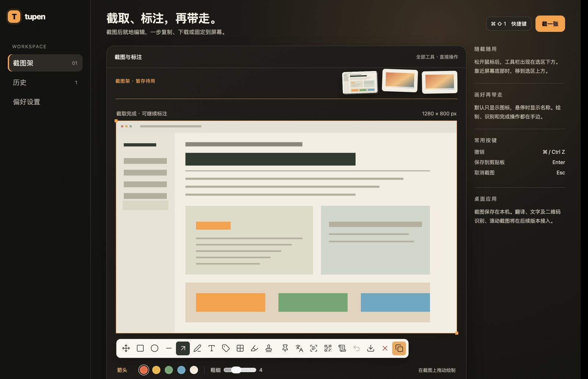
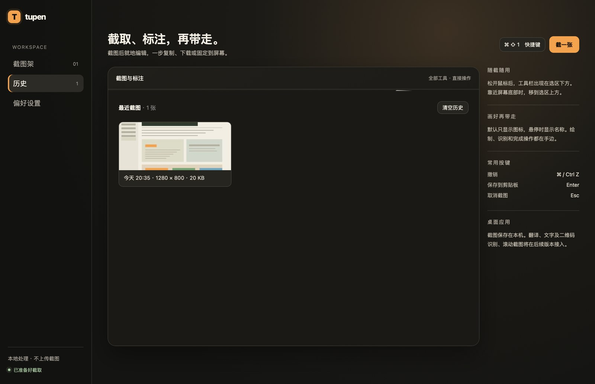
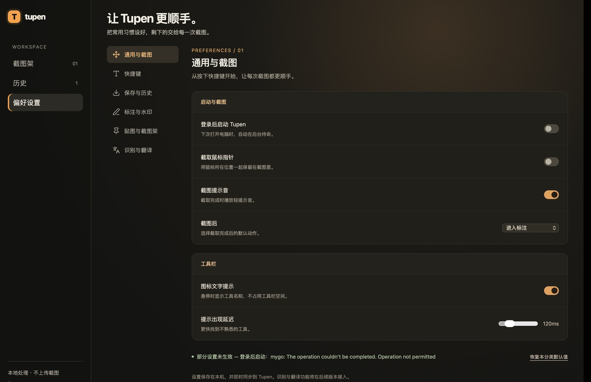
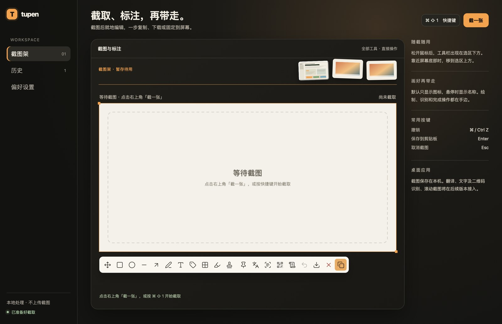

# Tupen

Tupen 是一个面向 macOS 和 Windows 的桌面截图与标注工具。它把「截取屏幕 → 就地标注 → 复制 / 导出 / 固定到屏幕 → 回到历史」放进同一条工作流，截图默认只保存在本机。

桌面外壳使用 [MyGo](https://mygo.egoist.dev/)（Go + 系统 WebView，纯 Go、无 cgo），界面是设计稿演化而来的 Vite 前端。

## 当前状态

真实可用（macOS 已在本机端到端验证）：

- **区域截图**：全局快捷键或托盘菜单唤起全屏选区，遮罩 + 十字线 + 尺寸角标，Esc / 右键取消；Retina 截图保持 2x 像素
- **标注**：矩形、圆形、直线、箭头、画笔、文字、标签、马赛克、高亮、水印，颜色 / 粗细可调，支持撤销与拖动移动
- **保存到剪贴板**：把带标注的 PNG 写入系统剪贴板
- **下载 / 导出**：按设置里的 PNG / JPEG、质量、文件名前缀走系统保存对话框，并默认定位到设置里的「默认保存文件夹」
- **固定到屏幕**：无边框置顶贴图窗口，可关闭；支持固定剪贴板图片
- **历史与截图架**：截图自动落盘、真实缩略图、点击载入编辑器、单条删除 / 清空；保留天数与容量上限生效
- **托盘**：菜单栏常驻图标：截取区域 / 截取整个屏幕 / 固定剪贴板图片 / 显示主窗口 / 退出
- **全局快捷键**：默认 ⌘⇧1（截取区域）、⌘⇧2（固定剪贴板图片）、⌘⇧O（提取文字，能力待接入）；可在设置里重新录制，注册失败会提示
- **设置**：6 个分类、localStorage 持久化，并实时推给 Go 侧生效（截图后动作、光标、提示音、格式、默认保存文件夹、登录启动、历史保留策略、贴图透明度/边框等）

仍是「待接入」占位（点开有明确说明，不会假装可用）：OCR 文字识别、翻译、二维码识别、滚动截图。

平台情况：macOS 已构建并验证；Windows 有纯 Go 的 GDI 截图后端且交叉编译通过，**尚未在 Windows 真机验证**。

## 截图

编辑器（截图后真实载入画布；截图为演示用合成图，不含用户桌面内容）：



历史：



偏好设置：



截图架：



设计稿快照（交互原型，作为视觉基准保留）：[outputs/tupen-design.html](outputs/tupen-design.html)。可以在仓库根目录运行任意静态文件服务器查看：

```bash
python3 -m http.server 8765
# 打开 http://127.0.0.1:8765/outputs/tupen-design.html
```

## 开发

需要 Go 1.27.3+、Node.js 22+ 与 npm。

```bash
npm install

# 构建前端产物
npm run build:web

# 运行 Go 测试（含 native 截图 integration 测试需屏幕录制权限）
GOTOOLCHAIN=auto go test ./...
GOTOOLCHAIN=auto go test -tags integration ./internal/capture

# 启动桌面开发环境（Vite + MyGo 窗口，支持热更新）
npm run dev

# 构建 .app / .dmg（产物在 build/darwin-arm64/）
npx mygo build
```

### 结构

```
cmd/tupen/main.go            桌面入口：单实例、绑定服务、窗口与托盘生命周期
internal/app/                编排层：截图流程、绑定服务、事件、托盘、快捷键、设置、自检
internal/capture/            平台截图后端（macOS screencapture / Windows GDI）+ 权限 + 选择框几何
internal/store/              历史持久化：PNG + 缩略图 + index.json + 保留策略
frontend/index.html          主窗口（截图架 / 历史 / 设置）
frontend/overlay.html        全屏选区覆盖层
frontend/pin.html            置顶贴图窗口
frontend/src/                TypeScript 模块（bridge 是唯一的原生调用入口）
vite.config.ts               三页多入口构建
work/plan.md                 本轮开发的冻结接口契约与实测结论
work/e2e.sh                  端到端验收脚本（构建 + 12 项 selftest）
```

### 端到端验收

```bash
bash work/e2e.sh            # 完整构建 + 全部自检
bash work/e2e.sh --skip-build   # 用现有构建产物只跑自检
```

脚本会依次跑 Go 测试 / vet / Windows 交叉编译、前端与桌面构建，以及 12 项应用级自检（真实退出、真实截图、历史、剪贴板、选区映射像素级对比、Esc 取消、编辑器交付、工具栏动作、主窗口视图、贴图、全局快捷键注册、设置应用）。自检通过环境变量驱动（`TUPEN_SELFTEST=quit|capture|overlay|drag|esc|deliver|uiactions|uicapture|pin|history|hotkeys|settings|demo|hold`），产物与日志在 `/tmp/tupen-selftest-*`。

### 数据与权限

- 历史目录：`~/Library/Application Support/Tupen/captures/`（PNG + `*.thumb.jpg` + `index.json`）
- 当前会话缓存：`~/Library/Caches/Tupen/session/`（应用启动时清空）
- 页面通过内部自定义协议 `shot://localhost/...` 读取这些图片，不经过网络
- 首次截图需要「屏幕录制」权限：系统设置 → 隐私与安全性 → 屏幕录制；权限缺失时应用会提示并可直接跳转设置页

## 已知限制

- **Windows 未真机验证**（GDI 后端仅保证纯 Go 交叉编译通过；坐标按物理像素解释，与 macOS 的 point 语义不同，HiDPI 缩放下选区可能错位，当前按「基础实现」看待）
- **OCR / 翻译 / 二维码 / 滚动截图** 尚未接入服务，UI 明确标注「待接入」
- **overlay 覆盖的是屏幕可见工作区**（macOS 的 Panel 会被 AppKit 约束在菜单栏与 Dock 之外），无法直接框选菜单栏 / Dock 区域；选区坐标按窗口实际 frame 换算，截图内容不受影响
- **登录启动** 在未安装到 `/Applications` 的构建里会返回 `Operation not permitted`，设置页会如实展示；安装后的行为待人工确认
- **导出保存对话框**未纳入自动化自检（模态框），导出与格式转换逻辑由单元测试覆盖，建议人工点一次确认
- 全局快捷键通过 Carbon `RegisterEventHotKey` 注册（注册成功）；合成按键无法触发 Carbon 热键，自动化只能验证注册状态，**真实按键建议人工确认一次**
- 多显示器：overlay 只出现在鼠标所在显示器；DPI/缩放不同的混合显示器组合未充分测试

## 技术方向

- 桌面框架：MyGo（https://mygo.egoist.dev/）
- 图标：Lucide（ISC，社区开源图标库）
- 目标平台：macOS、Windows
- 当前阶段：核心截图链路已打通，继续补齐识别类能力与 Windows 验证
