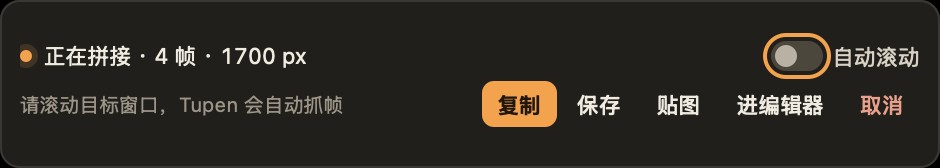

# Tupen

Tupen 是一个面向 macOS 和 Windows 的桌面截图与标注工具。它把「截取屏幕 → 在选区旁就地操作（标注 / 复制 / 贴图 / 保存）→ 把截图挂在桌面上 → 回到历史」放进同一条工作流，截图默认只保存在本机。

桌面外壳使用 [MyGo](https://mygo.egoist.dev/)（Go + 系统 WebView，纯 Go、无 cgo），界面是设计稿演化而来的 Vite 前端。

## 当前状态

真实可用（macOS 已在本机端到端验证）：

- **区域截图 + 就地完整工具栏**：全局快捷键或托盘唤起全屏选区，遮罩 + 十字线 + 尺寸角标；松手后 Go **透过透明选区直接截屏（无闪烁）**、overlay 就地把截图显示在选区里，并浮出**完整标注工具栏**——矩形/圆/直线/箭头/画笔/文字/标签/马赛克/高亮/水印、颜色与粗细、撤销，翻译 / 提取文字 / 二维码（标注「待接入」）、滚动截图（真实功能），以及复制 / 贴图 / 保存 / 进入编辑器 / 取消。标注直接发生在桌面上，不用先跳窗口（Enter 复制、⌘Z 撤销、Esc 取消）
- **文字/标签**：选中工具后在画面上点击要放文字的位置，输入框就地出现直接输入；Enter 提交、Shift+Enter 换行、Esc 取消（与主流截图工具一致），主编辑器同样适用
- **调色板**：8 个预设色 + 自定义取色器 + 最近使用颜色（持久化，overlay 与主编辑器共享）
- **权限引导**：屏幕录制权限缺失时在选区原地提示「需要屏幕录制权限」并可一键打开系统设置，不再突然跳进主窗口
- **主窗口编辑器**：点「进入编辑器」把带标注的合成图交给主窗口继续精修；历史截图也在这里重新编辑
- **复制 / 导出**：一键写入剪贴板；按设置里的 PNG / JPEG、质量、文件名前缀走系统保存对话框，并默认定位到设置里的「默认保存文件夹」
- **挂在桌面（贴图）**：始终置顶的无边框贴图窗口；拖动摆放、滚轮缩放、右下角手柄按比例缩放、⌘/Ctrl+滚轮调透明度、右键菜单（复制 / 保存 / 关闭 / 透明度 / 原始大小）、双击复制、Esc 关闭；多张各自独立摆放，**重启应用后自动恢复**（图片、位置、大小、透明度）
- **滚动截图**：选区里点「滚动截图」后进入独立控制条模式——overlay 隐藏，你直接滚动目标窗口，Tupen 自动抓帧并按重叠拼接成长图（也可开「自动滚动」，需要 macOS「辅助功能」权限）；完成后复制 / 保存 / 贴图 / 进编辑器，长图同样进历史
- **历史**：截图自动落盘、真实缩略图、点击载入编辑器、单条删除 / 清空；保留天数与容量上限生效
- **托盘**：菜单栏常驻图标：截取区域 / 截取整个屏幕 / 固定剪贴板图片 / 显示主窗口 / 退出
- **全局快捷键**：默认 ⌘⇧1（截取区域）、⌘⇧2（固定剪贴板图片）、⌘⇧O（提取文字，能力待接入）；可在设置里重新录制，注册失败会提示
- **设置**：6 个分类、localStorage 持久化，并实时推给 Go 侧生效（截图后就地标注/复制/贴图/进编辑器、光标、提示音、格式、默认保存文件夹、登录启动、历史保留策略、贴图透明度/边框等）

仍是「待接入」占位（点开有明确说明，不会假装可用）：OCR 文字识别、翻译、二维码识别。

平台情况：macOS 已构建并验证；Windows 有纯 Go 的 GDI 截图后端且交叉编译通过，**尚未在 Windows 真机验证**。

## 截图

以下截图均使用合成图/自绘遮罩，不含用户桌面内容。

拖选区域后，选区里就直接显示截图并浮出完整标注工具栏（截图为合成演示内容，含一枚演示标注）：


点「标注」进入编辑器：


把截图挂在桌面（贴图，始终置顶）：


滚动截图控制条（手动滚动抓帧拼接，可选自动滚动）：



历史：


偏好设置：


设计稿快照（交互原型，作为视觉基准保留）：[outputs/tupen-design.html](outputs/tupen-design.html)。可以在仓库根目录运行任意静态文件服务器查看：

```bash
python3 -m http.server 8765
# 打开 http://127.0.0.1:8765/outputs/tupen-design.html
```

## 开发

需要 Go 1.27.3+、Node.js 22+ 与 npm。

```bash
npm install

# 构建前端产物
npm run build:web

# 运行 Go 测试（含 native 截图 integration 测试需屏幕录制权限）
GOTOOLCHAIN=auto go test ./...
GOTOOLCHAIN=auto go test -tags integration ./internal/capture

# 启动桌面开发环境（Vite + MyGo 窗口，支持热更新）
npm run dev

# 构建 .app / .dmg（产物在 build/darwin-arm64/）
npx mygo build
```

### 结构

```
cmd/tupen/main.go            桌面入口：单实例、绑定服务、窗口与托盘生命周期
internal/app/                编排层：截图流程、绑定服务、事件、托盘、快捷键、设置、自检
internal/capture/            平台截图后端（macOS screencapture / Windows GDI）+ 权限 + 选择框几何
internal/store/              历史持久化：PNG + 缩略图 + index.json + 保留策略
internal/pin/                桌面贴图持久化：图片 + pins.json（位置/大小/透明度）
frontend/index.html          主窗口（截图 / 历史 / 设置）
frontend/overlay.html        全屏选区覆盖层
frontend/pin.html            置顶贴图窗口
frontend/src/                TypeScript 模块（bridge 是唯一的原生调用入口）
vite.config.ts               四页多入口构建（index/overlay/pin/scroll）
work/plan.md                 本轮开发的冻结接口契约与实测结论
work/e2e.sh                  端到端验收脚本（构建 + 16 项 selftest）
```

### 端到端验收

```bash
bash work/e2e.sh            # 完整构建 + 全部自检
bash work/e2e.sh --skip-build   # 用现有构建产物只跑自检
```

脚本会依次跑 Go 测试 / vet / Windows 交叉编译、前端与桌面构建，以及 16 项应用级自检（真实退出、真实截图+历史+剪贴板、overlay 渲染、选区映射像素级对比、Esc 取消、**就地标注全流程 copy/pin/editor/cancel + afterCapture 自动动作**、**桌面贴图交互（双击/菜单/滚轮/关闭）**、**贴图重启恢复**、**滚动截图拼接与页面全流程**、编辑器交付、编辑器内动作、主窗口视图、贴图窗口、全局快捷键注册、设置应用）。自检通过环境变量驱动（`TUPEN_SELFTEST=quit|capture|overlay|drag|esc|flow|pinpersist-setup|pinpersist-check|scroll|scrollflow|deliver|uiactions|uicapture|pin|history|hotkeys|settings|showcase|scrollshot|demo|hold`），产物与日志在 `/tmp/tupen-selftest-*`。

### 数据与权限

- 历史目录：`~/Library/Application Support/Tupen/captures/`（PNG + `*.thumb.jpg` + `index.json`）
- 桌面贴图：`~/Library/Application Support/Tupen/pins/`（`<id>.png` + `pins.json`，重启后按此恢复）
- 当前会话缓存：`~/Library/Caches/Tupen/session/`（应用启动时清空）
- 页面通过内部自定义协议 `shot://localhost/...` 读取这些图片，不经过网络
- 首次截图需要「屏幕录制」权限：系统设置 → 隐私与安全性 → 屏幕录制；权限缺失时应用会提示并可直接跳转设置页
- 开发/自检可用 `TUPEN_DATA_DIR=/tmp/tupen-data` 把 captures、pins、session 全部隔离到指定目录（默认行为不变；生成 README 截图的 `TUPEN_SELFTEST=showcase` 强制要求设置该变量，避免读到真实历史）

## 已知限制

- **Windows 未真机验证**（GDI 后端仅保证纯 Go 交叉编译通过；坐标按物理像素解释，与 macOS 的 point 语义不同，HiDPI 缩放下选区可能错位，当前按「基础实现」看待）
- **OCR / 翻译 / 二维码** 尚未接入服务，UI 明确标注「待接入」
- **滚动截图**：手动模式已可用；Windows 上手动拼接引擎同样编译可用但未真机验证；自动滚动依赖 macOS「辅助功能」权限，滚轮事件在部分 App（自绘滚动/虚拟列表）可能不生效，建议先用手动模式；固定表头/表尾（网页顶栏、聊天输入框）会造成拼接错位，请框选内部滚动区；上限 120 帧 / 30000px
- **overlay 覆盖的是屏幕可见工作区**（macOS 的 Panel 会被 AppKit 约束在菜单栏与 Dock 之外），无法直接框选菜单栏 / Dock 区域；选区坐标按窗口实际 frame 换算，截图内容不受影响
- **登录启动** 在未安装到 `/Applications` 的构建里会返回 `Operation not permitted`，设置页会如实展示；安装后的行为待人工确认
- **导出 / 保存对话框**未纳入自动化自检（模态框），导出、格式转换与保存路径逻辑由单元测试覆盖，建议人工点一次确认
- 贴图恢复依赖保存时导出的几何信息：显示器拔插后越界的贴图会被夹回可见屏幕，但不会自动按比例重新排版
- 贴图数量上限 60 张（防止异常状态把桌面塞满），超过时旧贴图不恢复
- 全局快捷键通过 Carbon `RegisterEventHotKey` 注册（注册成功）；合成按键无法触发 Carbon 热键，自动化只能验证注册状态，**真实按键建议人工确认一次**
- 多显示器：overlay 只出现在鼠标所在显示器；DPI/缩放不同的混合显示器组合未充分测试

## 技术方向

- 桌面框架：MyGo（https://mygo.egoist.dev/）
- 图标：Lucide（ISC，社区开源图标库）
- 目标平台：macOS、Windows
- 当前阶段：核心截图链路与桌面贴图已打通，继续补齐识别类能力与 Windows 验证
