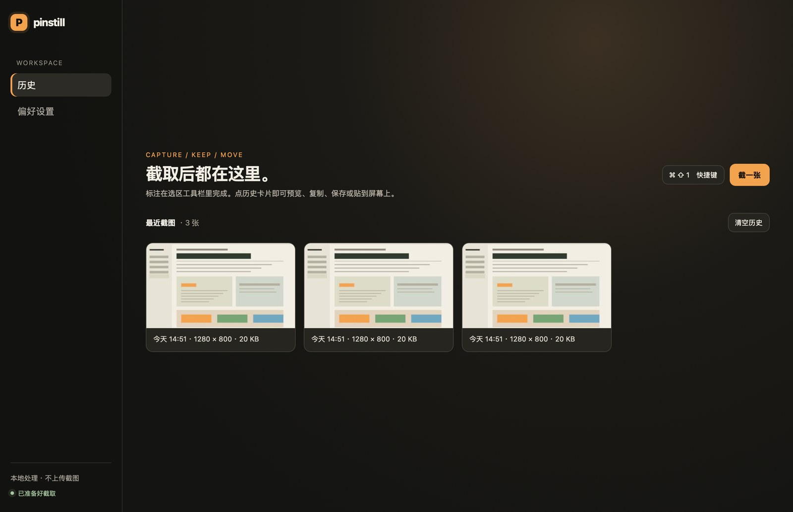
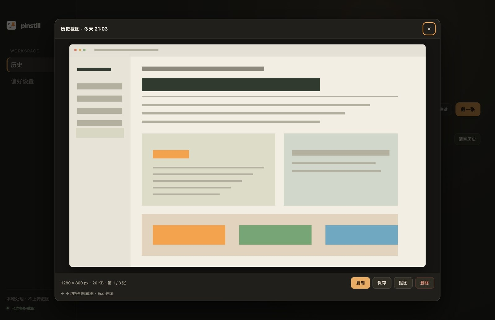

# Pinstill · 钉图

**截屏 → 就地标注 → 复制 / 贴图 / 保存 → 回到历史**，一条快捷键全部完成。
纯 Go + 系统 WebView，无 Electron、无 cgo；截图只在本机处理，不上传任何内容。

[English](README.en.md) · [特性](#特性) · [截图](#截图) · [从源码构建](#从源码构建) · [使用](#使用) · [架构](#架构) · [开发与测试](#开发与测试) · [已知限制](#已知限制) · [参与贡献](#参与贡献)

[](https://github.com/echoVic/Pinstill/actions/workflows/ci.yml)
[](LICENSE)

-lightgrey)


## 这是什么

Pinstill（pin + still）是一个 macOS / Windows 的桌面截图与标注工具。它把
「截取屏幕 → 在选区旁就地操作 → 把截图挂在桌面上 → 回到历史」放进同一条工作流：

- 截图后**不跳窗口**，截图直接显示在桌面选区里，标注工具栏就浮在旁边；
- 贴图是始终置顶的无边框窗口，可以随手摆、缩放、调透明度，重启后自动恢复；
- 历史默认可按保留天数 / 容量上限自动清理，截图文件保存在本机。

桌面外壳使用 [MyGo](https://mygo.egoist.dev/)（Go + 系统 WebView，纯 Go、无 cgo），
界面是 Vite + TypeScript 的多页面前端。macOS 已端到端验证；Windows 有 GDI 截图后端且
交叉编译通过，**尚未真机验证**。

## 特性

**截图与标注**

- **区域截图 + 就地完整工具栏**：全局快捷键或托盘唤起全屏选区，遮罩 + 十字线 + 尺寸角标；松手后 Go **透过透明选区直接截屏（无闪烁）**，overlay 就地把截图显示在选区里，并浮出**完整标注工具栏**（可按住手柄拖到不挡内容的位置；截取后还可拖动选区**四角**调整范围，松开即重新截取）
- 工具：矩形 / 圆 / 直线 / 箭头 / 画笔 / 文字 / 标签 / 马赛克 / 高亮 / 水印，撤销（⌘Z），颜色与粗细（默认 2px，可调），翻译 / 提取文字 / 二维码（标注「待接入」）
- **文字样式**：粗体 / 斜体、字号 10–32pt（默认 14pt）、字体（系统默认 / 苹方 / Helvetica / Georgia / Menlo），样式会记住并在输入框里实时预览
- **平铺水印**：点水印工具即把**斜向（-30°）、稀疏平铺的水印文字**铺满整张截图，可调文字 / 不透明度（10–90%）/ 颜色 / 字号；再点一次即可关闭，导出图片自动包含水印
- **调色板**：40 个预设色 + 饱和度/明度方块 + 色相滑条 + HEX 输入 + 最近 8 色（持久化）；Esc 只关面板、不取消截图
- **权限引导**：屏幕录制权限缺失时在选区原地提示并可一键打开系统设置
- 快捷键：Enter 或**双击画布**复制、Esc 取消；支持「截图后」自动复制 / 自动贴图

**贴图与历史**

- **挂在桌面（贴图）**：始终置顶的无边框贴图窗口；拖动摆放、滚轮缩放、右下角手柄按比例缩放、⌘/Ctrl+滚轮调透明度、右键菜单（复制 / 保存 / 关闭 / 透明度 / 原始大小）、双击复制、Esc 关闭；多张各自独立摆放，**重启应用后自动恢复**
- **历史与预览**：截图自动落盘、真实缩略图卡片；点击打开大图预览（复制 / 保存 / 贴图 / 删除，←/→ 切换、Esc 关闭）、单条删除 / 清空；保留天数与容量上限生效。主窗口只有历史 + 偏好设置
- **整屏截图**：托盘菜单「截取整个屏幕」静默截取鼠标所在显示器 → 存历史 → 按「截图后」执行（默认复制到剪贴板）
- **复制 / 导出**：写入剪贴板；按设置里的 PNG / JPEG、质量、文件名前缀走系统保存对话框，并定位到默认保存文件夹

**滚动截图**

- 选区里点「滚动截图」后 overlay 隐藏、浮出紧凑控制条，同时**选区范围框**（画在选区外的 2px 边框，不会进长图）保持显示，随时知道正在截哪一块
- 默认自动滚动并抓帧拼接，到底 / 停顿约 1.2 秒 / 达到上限（120 帧 / 30000px）时**自动完成**并弹出长图结果预览（复制 / 保存 / 贴图 / 关闭）
- 依赖 macOS「辅助功能」权限，未授权时自动降级为手动滚动；控制条可暂停 / 继续、切换自动 / 手动、立即完成、取消，长图同样进历史

**系统集成**

- **托盘**：菜单栏常驻图标：截取区域 / 截取整个屏幕 / 固定剪贴板图片 / 历史与设置 / 退出
- **全局快捷键**：默认 ⌘⇧1（截取区域）、⌘⇧2（固定剪贴板图片）、⌘⇧O（提取文字，能力待接入）；可在设置里重新录制
- **设置**：7 个分类（通用与截图 / 快捷键 / 保存与历史 / 标注与水印 / 贴图与桌面 / 识别与翻译 / 权限），localStorage 持久化并实时推给 Go 侧生效
- **权限中心**：实时显示屏幕录制、辅助功能、登录时启动的真实系统状态，可请求权限、打开系统设置、重新检测；缺少屏幕录制权限时主窗口显示引导横幅

> OCR / 翻译 / 二维码识别仍是「待接入」占位（点开有明确说明，不会假装可用）。

## 截图

以下截图均使用合成图 / 自绘遮罩生成，不含任何用户桌面内容（由 `PINSTILL_SELFTEST=showcase` 产出）。

斜向平铺水印（水印工具 + 文字 / 不透明度设置行，实时预览）：


把截图挂在桌面（贴图，始终置顶）：


滚动截图：默认自动滚动，控制条可暂停 / 切手动 / 立即完成：


滚动截图完成后的长图预览（复制 / 保存 / 贴图 / 关闭，Esc 关闭）：


历史（主窗口只有历史 + 偏好设置）：



点击历史卡片打开大图预览（←/→ 切换、Esc 关闭）：



偏好设置：


设计稿快照（交互原型，作为视觉基准保留）：[outputs/pinstill-design.html](outputs/pinstill-design.html)。
在仓库根目录运行任意静态文件服务器即可查看，例如：

```bash
python3 -m http.server 8765
# 打开 http://127.0.0.1:8765/outputs/pinstill-design.html
```

## 从源码构建

### 环境要求

- macOS 13+（Apple Silicon / Intel），已安装 Xcode Command Line Tools
- Go **1.27+**（版本以 [go.mod](go.mod) 为准）
- Node.js **22+** 与 npm

### 构建

```bash
git clone https://github.com/echoVic/Pinstill.git
cd Pinstill

npm install
npm run build:web          # 构建前端产物到 dist/
./node_modules/.bin/mygo build
# 或 npm run build

open build/darwin-arm64/Pinstill.app
```

产物在 `build/darwin-arm64/`（`.app` 与 `.dmg`）。

开发模式（Vite 热更新 + MyGo 窗口）：

```bash
npm run dev
```

## 使用

1. 启动后常驻菜单栏；按 **⌘⇧1**（或点托盘「截取区域」）进入选区。
2. 拖选区域 → 松手即完成截屏并浮出标注工具栏；直接标注，Enter / 双击画布复制，Esc 取消。
3. 拖选区四角可调整范围，松手重新截取；点「滚动截图」进入长截图。
4. 点「贴图」把截图钉在桌面；点「保存」走系统保存对话框；点「复制」进剪贴板。
5. 托盘 →「历史与设置」查看历史与全部偏好。

快捷键与行为都可以在**设置**里修改；「截图后」可设为就地标注（默认）/ 复制 / 贴图。

## 数据与权限

- 历史目录：`~/Library/Application Support/Pinstill/captures/`（PNG + `*.thumb.jpg` + `index.json`）
- 桌面贴图：`~/Library/Application Support/Pinstill/pins/`（`<id>.png` + `pins.json`，重启后按此恢复）
- 当前会话缓存：`~/Library/Caches/Pinstill/session/`（应用启动时清空）
- 页面通过内部自定义协议 `shot://localhost/...` 读取这些图片，**不经过网络，也不上传任何内容**
- 首次截图需要「屏幕录制」权限：系统设置 → 隐私与安全性 → 屏幕录制；权限缺失时应用会原地提示并可跳转
- 滚动截图自动滚动需要「辅助功能」权限（未授权自动降级为手动）
- 开发 / 自检可用 `PINSTILL_DATA_DIR=/tmp/pinstill-data` 把 captures、pins、session 隔离到指定目录
  （生成 README 截图的 `PINSTILL_SELFTEST=showcase` 强制要求设置该变量，避免读到真实历史）

## 架构

```
┌────────────────────────────── macOS / Windows ──────────────────────────────┐
│  MyGo (Go + 系统 WebView, 纯 Go / 无 cgo)                                     │
│                                                                              │
│  internal/app      编排层：截图流程、窗口、托盘、快捷键、设置、滚动会话、自检      │
│  internal/capture  平台截图后端（macOS screencapture / Windows GDI）+ 权限预检  │
│  internal/store    历史持久化：PNG + 缩略图 + index.json + 保留策略              │
│  internal/pin      贴图持久化：图片 + pins.json（位置/大小/透明度）              │
│  internal/stitch   滚动截图拼接：重叠检测 + 累积                                │
│                                                                              │
│  ┌──────────────── Vite + TypeScript 多页面前端 ────────────────┐            │
│  │ index.html   主窗口（历史 / 设置）                            │            │
│  │ overlay.html 全屏选区 + 就地标注                              │            │
│  │ pin.html     置顶贴图窗口                                     │            │
│  │ scroll.html  滚动截图控制条                                   │            │
│  │ result.html  滚动截图长图预览                                 │            │
│  │ frame.html   滚动截图范围框（透明、点击穿透）                  │            │
│  └──────────────────────────────────────────────────────────────┘            │
└──────────────────────────────────────────────────────────────────────────────┘
```

- Go ↔ JS 通过 MyGo 的绑定（`mygo.BindAs`）与自定义事件通信；前端唯一原生入口是 `frontend/src/bridge.ts`
- 截图图像单向通过自定义协议读取（避免 base64 过大）；标注完成回传仍走 base64
- `work/plan.md` 记录了每轮开发的接口契约与实测结论，可作为实现细节参考

## 开发与测试

```bash
# 单元测试 / 静态检查
GOTOOLCHAIN=auto go test ./...
GOTOOLCHAIN=auto go vet ./...

# 真实截图后端集成测试（需要屏幕录制权限）
GOTOOLCHAIN=auto go test -tags integration ./internal/capture

# 前端构建
npm run build:web

# 端到端验收（构建 + 23 项应用级自检）
bash work/e2e.sh
bash work/e2e.sh --skip-build   # 用现有构建产物只跑自检
```

`work/e2e.sh` 依次执行 Go 测试 / vet / Windows 交叉编译、前端与桌面构建，以及 23 项自检：
真实退出、真实截图 + 历史 + 剪贴板、overlay 渲染、选区映射像素级对比、Esc 取消、就地标注全流程
（copy / pin / cancel + afterCapture）、桌面贴图交互、贴图重启恢复、滚动截图（自动 + 手动 + 结果预览）、
整屏截图、历史动作、主窗口视图、贴图窗口、全局快捷键注册、设置应用、权限中心、调色板、文字样式、
双击复制、选区四角调整、平铺水印等。

自检通过环境变量驱动，模式见下表；产物与日志在 `/tmp/pinstill-selftest-*`：

```text
PINSTILL_SELFTEST=quit|capture|overlay|drag|esc|flow|pinui|pinpersist-setup|pinpersist-check|
                  scroll|scrollflow|scrollmanual|fullscreen|historyactions|uicapture|pin|history|
                  hotkeys|settings|perms|palette|textstyle|dblclick|resize|watermark|showcase|scrollshot|hold
```

> 注意：自检会按单实例规则退出正在运行的应用，再以隔离数据目录启动；`showcase` / `scrollshot`
> 用于生成 README 截图，全部使用合成图像，不会把真实桌面内容写进仓库。

## 项目结构

```text
cmd/pinstill/main.go          桌面入口：单实例、绑定服务、窗口与托盘生命周期
internal/app/                 编排层：截图流程、绑定服务、事件、托盘、快捷键、设置、自检
internal/capture/             平台截图后端（macOS screencapture / Windows GDI）+ 权限 + 选择框几何
internal/store/               历史持久化：PNG + 缩略图 + index.json + 保留策略
internal/pin/                 桌面贴图持久化：图片 + pins.json
internal/stitch/              滚动截图拼接
frontend/index.html           主窗口（历史 / 设置）
frontend/overlay.html         全屏选区 + 就地标注
frontend/pin.html             置顶贴图窗口
frontend/scroll.html          滚动截图控制条
frontend/result.html          滚动截图长图预览
frontend/frame.html           滚动截图范围框
frontend/src/                 TypeScript 模块（bridge.ts 是唯一的原生调用入口）
vite.config.ts                多页面构建入口
work/e2e.sh                   端到端验收脚本（构建 + 23 项 selftest）
work/plan.md                  开发记录：接口契约与实测结论
```

## 已知限制

- **Windows 未真机验证**（GDI 后端仅保证纯 Go 交叉编译通过；坐标按物理像素解释，与 macOS 的 point 语义不同，HiDPI 缩放下选区可能错位）
- **OCR / 翻译 / 二维码** 尚未接入服务，UI 明确标注「待接入」
- **滚动截图**：默认自动滚动，依赖 macOS「辅助功能」权限（未授权自动降级为手动）；滚轮事件在部分 App（自绘滚动 / 虚拟列表）可能不生效；固定表头 / 表尾会拼接错位，请框选内部滚动区；连续 3 帧无变化（约 1.2 秒）会自动完成；上限 120 帧 / 30000px；Windows 拼接引擎未真机验证
- **overlay 覆盖的是屏幕可见工作区**（macOS Panel 被 AppKit 约束在菜单栏与 Dock 之外），无法直接框选菜单栏 / Dock 区域；选区坐标按窗口实际 frame 换算，截图内容不受影响
- **登录启动**在未安装到 `/Applications` 的构建里会返回 `Operation not permitted`，设置页会如实展示
- **导出 / 保存 / 历史另存对话框**未纳入自动化自检（模态框），建议人工确认一次
- 贴图恢复依赖保存时的几何信息：显示器拔插后越界的贴图会被夹回可见屏幕，不会自动重排
- 贴图数量上限 60 张；全局快捷键通过 Carbon `RegisterEventHotKey` 注册，自动化只能验证注册状态，真实按键建议人工确认
- 多显示器：overlay 只出现在鼠标所在显示器；DPI / 缩放不同的混合显示器组合未充分测试

## 路线图

- [x] 区域截图 + 就地标注工具栏 + 双击 / Enter 复制
- [x] 贴图（含重启恢复）、历史、滚动截图（自动 / 手动 + 结果预览）
- [x] 文字样式、调色板、斜向平铺水印、选区四角调整
- [x] 权限中心、登录启动、7 类偏好设置
- [ ] OCR / 翻译 / 二维码接入
- [ ] Windows 真机验证与适配
- [ ] 提供二进制 release

## 参与贡献

欢迎 Issue / PR。提交前请尽量保证：

- `gofmt -l .` 无输出、`GOTOOLCHAIN=auto go vet ./...` 与 `go test ./...` 通过；
- 改动前端或交互时跑一次 `bash work/e2e.sh --skip-build`（完整构建版本更佳）；
- 不要提交 `build/`、`dist/`、`node_modules/`、真实桌面截图或本机私有配置；
- 提交信息使用 `feat: / fix: / docs: / perf: / test:` 前缀，说明「为什么」而不只是「改了什么」。

## License

[MIT](LICENSE) © 2026 echovic

## 致谢

- [MyGo](https://mygo.egoist.dev/) — Go + 系统 WebView 的桌面框架
- [Vite](https://vite.dev/) — 前端构建
- [Lucide](https://lucide.dev/) — 图标（ISC）
- 以及所有上游开源依赖的作者
